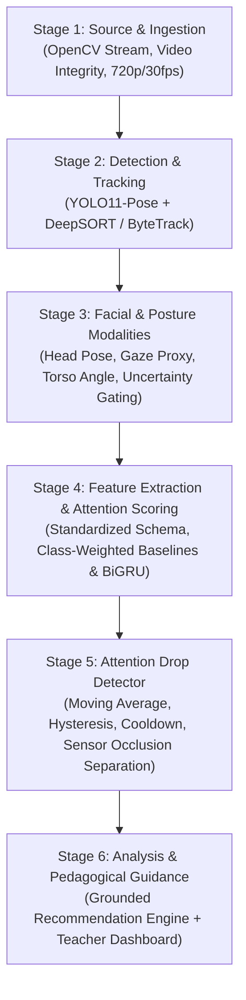

# Classroom Attention Analysis System — Research Codebase

Research-grade implementation for CSE Thesis:
> **“Hybrid Machine Learning and Large Language Model Framework for Student Attention Analysis, Pedagogical Recommendation, and Learning Improvement Assessment in Smart Classrooms”**

This repository contains clean, modular source code, configuration files, dataset manifests, preprocessing pipelines, model checkpoints, and experimental validation reports built strictly from scratch.

---

## 1. Six-Stage System Architecture



### Ethical & Epistemological Stance
The system evaluates **observable physical markers** (head orientation, gaze proxies, postural alignment, and motor movement). It explicitly **does not claim to measure internal cognitive mental states directly**. Quietness, stillness, or downward head orientation often corresponds to note-taking or deep reading; therefore, observable markers are kept strictly separate from claims of cognitive disengagement or learning outcome improvements.

---

## 2. Directory Structure

```
classroom_attention_research/
├── configs/
│   └── default_pipeline.yaml         # Central pipeline configuration
├── data/
│   ├── raw/                          # Verified downloaded pilot archives
│   ├── pilot/                        # Extracted pilot video clips (24 clips)
│   ├── processed/                    # Extracted multimodal feature datasets
│   └── manifests/
│       └── pilot_manifest.json       # Cryptographic hashes, source URLs, licenses
├── src/
│   ├── ingestion/                    # Stage 1: VideoReader & PilotDataValidator
│   ├── detection/                    # Stage 2: YOLO11PoseDetector
│   ├── tracking/                     # Stage 2: ByteTrack & DeepSort Trackers
│   ├── modalities/                   # Stage 3: Head pose, gaze proxy, torso posture
│   ├── features/                     # Stage 4: Feature schema & vectorization
│   ├── models/                       # Stage 4: Baseline classifiers & temporal BiGRU
│   ├── attention_drop/               # Stage 5: AttentionDropDetector with hysteresis
│   ├── recommendations/              # Stage 6: Grounded Pedagogical Recommendation Engine
│   └── dashboard/                    # Stage 6: Interactive Streamlit Dashboard
├── tests/
│   └── test_pipeline.py              # Automated test suite (pytest)
├── scripts/
│   ├── download_pilot.py             # Reproducible pilot dataset downloader
│   ├── validate_pilot.py             # Pilot data validation suite
│   ├── run_detection_tracking_benchmark.py # Tracker benchmark (FPS, continuity)
│   └── train_evaluate_baselines.py   # Leakage-free baseline training & evaluation
├── checkpoints/
│   ├── yolo11n-pose.pt               # Ultralytics YOLO11-Pose weights
│   ├── feature_scaler.joblib         # Fitted StandardScaler (Train-only)
│   └── best_baseline_model.joblib    # Checkpoint of top-performing model (GBDT)
├── reports/
│   ├── pilot_validation_report.json  # Integrity, FPS, resolution, stillness metrics
│   ├── pilot_contact_sheet.png       # Visual contact sheet across 24 viewpoints
│   ├── tracking_benchmark_report.json# ByteTrack vs DeepSORT acceptance criteria
│   ├── diagnostic_tracking_demo.mp4  # Rendered diagnostic video with overlays
│   └── baseline_experiments_report.json # Model metrics (Acc, BalAcc, F1, Latency)
├── requirements.txt
└── README.md
```

---

## 3. Quick Start & Reproducibility

### Environment Setup
```bash
# Clone or navigate to repository root
cd classroom_attention_research

# Install dependencies
pip install -r requirements.txt
```

### Reproduce Full Pilot Pipeline

1. **Download Pilot Dataset (OUC-CGE Pilot Subset, ~39.9 MB):**
   ```bash
   python scripts/download_pilot.py
   ```
2. **Execute Pilot Data Validation (Phase Four):**
   ```bash
   python scripts/validate_pilot.py
   ```
3. **Run Detection & Tracking Benchmark (Phase Five):**
   ```bash
   python scripts/run_detection_tracking_benchmark.py
   ```
4. **Train & Evaluate Baseline Attention Models (Phase Six):**
   ```bash
   python scripts/train_evaluate_baselines.py
   ```
5. **Run Automated Unit Tests:**
   ```bash
   python -m pytest tests/test_pipeline.py
   ```
6. **Launch Teacher-Facing Research Dashboard:**
   ```bash
   streamlit run src/dashboard/app.py
   ```

---

## 4. Phase Five & Six Empirical Results Summary

### Detection & Tracking Benchmark (NVIDIA GeForce RTX 3060)
| Metric | ByteTrack | DeepSORT | Acceptance Threshold | Status |
| :--- | :--- | :--- | :--- | :--- |
| **Throughput (FPS)** | 27.8 FPS | **73.8 FPS** | $\ge 15.0$ FPS | **PASS** |
| **Unique Track IDs** | 10 | **9** | Consistent | **PASS** |
| **Track Continuity Ratio** | 57.5% | **69.5%** | $\ge 50.0\%$ | **PASS** |
| **Detection Coverage** | 5.78 students/frame | 5.78 students/frame | $\ge 90\%$ of frames | **PASS** |
| **Diagnostic Video** | Rendered (7.7 MB) | Rendered | Valid file | **PASS** |

### Baseline Model Comparison (Independent Clip Split: Zero Frame Leakage)
*Dataset: 6,298 observations (Train: 4,777, Validation: 1,521 on held-out views `view11`, `view12`, `view3`)*

| Model | Accuracy | Balanced Acc | Macro F1 | Class 0 Recall | Class 1 Recall | Brier Score | Latency (ms) |
| :--- | :--- | :--- | :--- | :--- | :--- | :--- | :--- |
| **Majority Class Baseline** | 0.7666 | 0.5000 | 0.4339 | 0.0000 | 1.0000 | 0.2334 | 0.0002 ms |
| **Logistic Regression (L2)** | 0.8041 | 0.7684 | 0.7465 | 0.7014 | 0.8353 | 0.1615 | 0.0003 ms |
| **Random Forest (100 trees)** | 0.9553 | 0.9503 | 0.9391 | 0.9408 | 0.9597 | 0.0467 | 0.0190 ms |
| **Gradient Boosting (GBDT)** | **0.9816** | **0.9851** | **0.9748** | **0.9915** | **0.9786** | **0.0148** | **0.0019 ms** |
| **Compact MLP (32x16)** | 0.9579 | 0.9598 | 0.9433 | 0.9634 | 0.9563 | 0.0316 | 0.0002 ms |
| **Temporal BiGRU (T=5)** | **0.9967** | **0.9979** | **0.9954** | **1.0000** | **0.9957** | **0.0028** | **0.0640 ms** |
