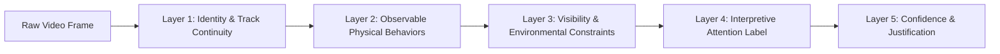

# Individual Attention Annotation Protocol: Expert Coding Manual

**Date**: October 27, 2026  
**Author**: Senior Computer Vision Research Engineer & ML Scientist  
**Target Application**: Individual Student Attention Analysis in Computer Vision Benchmarks  
**Document Version**: 1.0 (Pre-Registration Draft)  
**Status**: Pending Institutional Authorization Gate Approval

---

## 1. Scientific Philosophy & Non-Inferential Coding

Automated classroom attention analysis has historically suffered from the **ecological fallacy** (attributing whole-class engagement to individual students) and **behavioral reductionism** (conflating physical posture or eye position with cognitive attention).

### 1.1 The Epistemic Boundary of Computer Vision
Computer vision cameras capture **observable physical manifestations** (body posture, head orientation, limb movement, gaze vectors when visible, object interactions). Cameras **do not** directly measure mental cognition, focus, understanding, or neural processing.

Therefore, this protocol establishes a **strict multi-layered annotation schema**:
1. Human annotators must **first** record objective, observable physical behaviors without bias.
2. Annotators may **only** assign an interpretive attention label (`Attentive`, `Inattentive`, `Uncertain`) when the multi-cue evidence strictly satisfies pre-registered criteria.
3. Every ambiguous, occluded, or low-evidence frame must be assigned an explicit `Uncertain` label with a documented justification code.



---

## 2. Multi-Field Annotation Schema

Every annotation instance corresponds to a single visible student within a discrete temporal sample window ($t_k$). An annotation record comprises exactly five decoupled data fields:

### Field 1: Track Identity Continuity (`track_id`)
* **Type**: Integer ($1, 2, \dots, N$) or `ID_UNCERTAIN`.
* **Definition**: A continuous identity index associated with the student across the video sequence.
* **Rules**:
  - If a student leaves the frame or is completely occluded for $>3.0$ seconds and re-enters without unambiguous visual re-identification, assign a new track ID and flag `track_continuity_flag = BROKEN`.
  - If an identity swap is suspected due to crossing paths, mark `identity_confidence = UNCERTAIN`.

### Field 2: Observable Physical Behaviors (`observable_behaviors`)
* **Type**: Multi-select categorical array (one or more concurrent behaviors):
  1. `BEH_BOARD_TEACHER_ORIENTATION`: Head/torso oriented toward the front instructional area (chalkboard, whiteboard, screen, or standing instructor).
  2. `BEH_READING_DESK`: Eyes and head inclined downward toward physical textbooks, worksheets, or notebook materials on the desk surface.
  3. `BEH_WRITING_NOTETAKING`: Hand actively manipulating a pen, pencil, or stylus on a notebook, paper, or tablet screen.
  4. `BEH_DIGITAL_INTERACTION`: Hand holding or interacting with a mobile smartphone, tablet, or off-task digital device.
  5. `BEH_HEAD_ON_DESK`: Cranium resting directly on desk surface, folded arms, or slumped forward with complete loss of upright spinal posture.
  6. `BEH_PEER_INTERACTION`: Head oriented toward a neighboring student with visible facial articulatory movement (talking) or collaborative gesture.
  7. `BEH_NEUTRAL_UPRIGHT`: Torso upright, head facing forward/midline, hands idle, no active motor task.
  8. `BEH_OUT_OF_SEAT_MOVEMENT`: Student standing, stretching, turning body $>90^\circ$ away from desks, or shifting seat position.

### Field 3: Interpretive Attention Label (`attention_label`)
* **Type**: Categorical enum (`Attentive`, `Inattentive`, `Uncertain`):
  - **`Attentive`**: Strong visual evidence that the student is actively engaged with pedagogical instruction or task-aligned work (e.g., watching lecture, following board demonstrations, writing notes, reading lecture slides/handouts).
  - **`Inattentive`**: Clear, unambiguous visual evidence that the student has disengaged from instructional activity toward off-task distractions (e.g., active smartphone gaming/messaging, sleeping/head on desk, prolonged off-task peer banter).
  - **`Uncertain`**: Visual evidence is ambiguous, contradictory, transitional, or insufficient to render a defensible verdict.

### Field 4: Visibility & Environmental Gating (`visibility_status`)
* **Type**: Categorical enum:
  - `VIS_CLEAR`: Student is $>80\%$ visible; face bounding box height $\ge 24\text{ px}$; lighting and resolution sufficient for facial/pose feature extraction.
  - `VIS_PARTIALLY_OCCLUDED`: Between $30\%$ and $80\%$ of body is visible; torso or arms obstructed by foreground desks, chairs, or peers; head remains visible.
  - `VIS_SEVERELY_OCCLUDED_OR_DISTANT`: $<30\%$ of body visible, or student is seated in extreme rear rows where face height $<24\text{ px}$ and facial orientation is indiscernible.
  - `VIS_INSUFFICIENT_EVIDENCE`: Extreme motion blur, dark shadow, camera glare, or back completely turned to camera preventing any behavioral inference.

### Field 5: Annotation Confidence & Justification Reason (`confidence_metadata`)
* **Confidence Rating**: Ordinal scale $1$ to $5$:
  - $5$: Absolute certainty; clear unobstructed view, indisputable behavior.
  - $4$: High confidence; minor occlusion but evidence remains coherent.
  - $3$: Moderate confidence; partial inference required.
  - $2$: Low confidence; high ambiguity.
  - $1$: Pure speculation; must be coded as `Uncertain`.
* **Mandatory Justification Tag** (Required whenever `attention_label == Uncertain` or `Confidence < 4`):
  - `REASON_DOWNWARD_GAZE_AMBIGUITY`: Cannot differentiate between reading textbook vs. looking at concealed phone.
  - `REASON_OCCLUSION_DESK`: Desk/seatback obstructs hands, preventing confirmation of note-taking or device usage.
  - `REASON_DISTANCE_RESOLUTION`: Student located in rear rows; face $<24\text{ px}$, eyes unresolvable.
  - `REASON_TRANSITIONAL_GLANCE`: Student briefly glanced away for $<1.0\text{ s}$ during an otherwise attentive sequence.
  - `REASON_STILLNESS_DREAMING_VS_LISTENING`: Student is stationary facing front, but lack of facial cues prevents distinguishing deep listening from passive daydreaming.

---

## 3. Strict Non-Inferential Coding Rules

To eliminate annotator bias and prevent cognitive over-interpretation, annotators must adhere to the following **Four Golden Rules**:

```
+-----------------------------------------------------------------------------+
|                          FOUR GOLDEN CODING RULES                           |
+-----------------------------------------------------------------------------+
| 1. DOWNWARD GAZE != INATTENTIVE                                             |
|    Looking down at a textbook, worksheet, or notebook is normative academic |
|    engagement. Never mark Inattentive solely due to lowered eye pitch.     |
+-----------------------------------------------------------------------------+
| 2. NOTE-TAKING != INATTENTIVE                                               |
|    Active handwriting or drawing during a lecture represents high-level     |
|    attentive processing, even if the student is not looking at the board.  |
+-----------------------------------------------------------------------------+
| 3. PHONE VISIBILITY != INATTENTIVE                                          |
|    A phone resting idly on a desk does NOT establish inattention. Only      |
|    active manipulation (typing, scrolling, concealed browsing) qualifies.  |
+-----------------------------------------------------------------------------+
| 4. PHYSICAL STILLNESS != ATTENTIVE OR INATTENTIVE                           |
|    Stationary posture without motor activity can indicate rapt listening or |
|    cognitive disengagement. Must be corroborated by head orientation.       |
+-----------------------------------------------------------------------------+
```

### Detailed Edge Case Decision Trees

#### Edge Case A: Student Looking Down at Desk
```
Does student have a pen in hand actively writing on paper?
├── YES  ──> observable_behaviors: [BEH_WRITING_NOTETAKING, BEH_READING_DESK]
│            attention_label: Attentive (Confidence 4–5)
└── NO
     ├── Is an open book / worksheet visible and student's head slightly nodding / tracking lines?
     │    ├── YES  ──> observable_behaviors: [BEH_READING_DESK]
     │    │            attention_label: Attentive (Confidence 4)
     │    └── NO
     │         ├── Is a smartphone visible in student's hand / lap with finger scrolling?
     │         │    ├── YES  ──> observable_behaviors: [BEH_DIGITAL_INTERACTION]
     │         │    │            attention_label: Inattentive (Confidence 5)
     │         │    └── NO (Hands occluded beneath desk surface, head down $>3$s)
     │         │         └── observable_behaviors: [BEH_READING_DESK]
     │         │             attention_label: Uncertain (Confidence 2)
     │         │             justification: REASON_DOWNWARD_GAZE_AMBIGUITY
```

#### Edge Case B: Student Talking to Peer
```
Is the classroom in an active whole-class lecture mode?
├── YES
│    ├── Student turns head to peer, talks briefly (<2s) while pointing at notes/board?
│    │    └── attention_label: Uncertain / Attentive (Task-related clarification)
│    └── Student turns body toward peer for >3s, laughing or smiling, ignoring instructor?
│         └── observable_behaviors: [BEH_PEER_INTERACTION]
│             attention_label: Inattentive (Confidence 5)
└── NO (Group work / Collaborative exercise session)
     └── Peer interaction is instructional activity:
         └── attention_label: Attentive (Confidence 4)
```

#### Edge Case C: Rear-Row Distant Student ($<24\text{ px}$ Face)
```
Is face resolution < 24 px height or facial landmarks unresolvable by human eye?
├── Can gross torso orientation and posture be resolved?
│    ├── Slumped flat on desk surface?
│    │    └── observable_behaviors: [BEH_HEAD_ON_DESK]
│    │        attention_label: Inattentive (Confidence 4)
│    └── Torso upright, but cannot see eyes, hands, or facial direction?
│         └── observable_behaviors: [BEH_NEUTRAL_UPRIGHT]
│             visibility_status: VIS_SEVERELY_OCCLUDED_OR_DISTANT
│             attention_label: Uncertain (Confidence 1–2)
│             justification: REASON_DISTANCE_RESOLUTION
```

---

## 4. Multi-Annotator Protocol & Disagreement Adjudication

### 4.1 Team Structure
- **Primary Annotators ($A_1, A_2$)**: Two independent graduate researchers in Computer Vision / Educational Technology.
- **Senior Adjudicator ($A_{\text{lead}}$)**: Thesis supervisor or principal investigator.

### 4.2 Independent Labeling Workflow
1. **Pre-Annotation Training**: Both annotators undergo calibration training on 100 benchmark test frames (synthetic/dummy examples) to align on behavior definitions until pilot agreement $\kappa > 0.85$.
2. **Blinding Mandate**:
   - Annotators must be **strictly blinded** to dataset clip labels (`High` vs `Low` engagement from OUC-CGE).
   - Annotators must be **strictly blinded** to model predictions (YOLO, DeepSORT, or BiGRU outputs).
3. **Independent Pass**: $A_1$ and $A_2$ annotate each selected clip independently without communication or shared annotation files.

### 4.3 Adjudication Procedure
1. **Automated Discrepancy Flagging**: A script parses the exported JSON annotations and flags all instances where:
   - $A_1(\text{attention\_label}) \ne A_2(\text{attention\_label})$, OR
   - $A_1(\text{observable\_behaviors}) \cap A_2(\text{observable\_behaviors}) = \emptyset$, OR
   - $|A_1(\text{confidence}) - A_2(\text{confidence})| \ge 2$.
2. **Consensus Conference**: $A_1$ and $A_2$ review flagged discrepancy frames together with video playback at $0.25\times$ speed.
3. **Senior Adjudicator Ruling**: If consensus cannot be reached within 2 minutes of review, Senior Adjudicator $A_{\text{lead}}$ casts the binding tie-breaker.
4. **Resolution Categorization**: If the consensus reveals genuinely irreducible ambiguity, the ground-truth label **must default to `Uncertain`**, preserving scientific integrity over forced classification.

---

## 5. Measuring Inter-Annotator Agreement

Inter-annotator agreement must be quantified using standard statistical reliability metrics across both nominal behavior codes and interpretive attention labels.

### 5.1 Primary Reliability Metric: Krippendorff's Alpha ($\alpha$)
Because annotations involve multiple categorical choices, missing entries due to occlusion, and ordinal confidence scales, **Krippendorff's $\alpha$** is the designated primary agreement statistic:

$$\alpha = 1 - \frac{D_o}{D_e}$$

where $D_o$ is the observed disagreement and $D_e$ is the expected disagreement by chance.

* **Nominal Metric**: Used for `observable_behaviors` and `attention_label`.
* **Ordinal Metric**: Used for `confidence_rating` ($1$ to $5$) and `visibility_status`.

### 5.2 Secondary Reliability Metric: Cohen's / Fleiss' Kappa ($\kappa$)
For paired pairwise comparison of the 3-class attention labels (`Attentive`, `Inattentive`, `Uncertain`):

$$\kappa = \frac{P_o - P_e}{1 - P_e}$$

### 5.3 Agreement Targets (Pre-Registered Targets vs. Claims)
> [!IMPORTANT]
> The thresholds below represent **strict quality targets required for benchmark acceptance**. They are **not** claimed achievements:
> - **Acceptable Agreement**: $\alpha \ge 0.70$, $\kappa \ge 0.65$.
> - **High-Quality Ground Truth**: $\alpha \ge 0.80$, $\kappa \ge 0.75$.
> - **Reject / Recalibrate Protocol**: If $\alpha < 0.70$, the pilot is declared invalidated; annotators must be retrained, ambiguous behavioral definitions revised, and the sample re-annotated from scratch.
