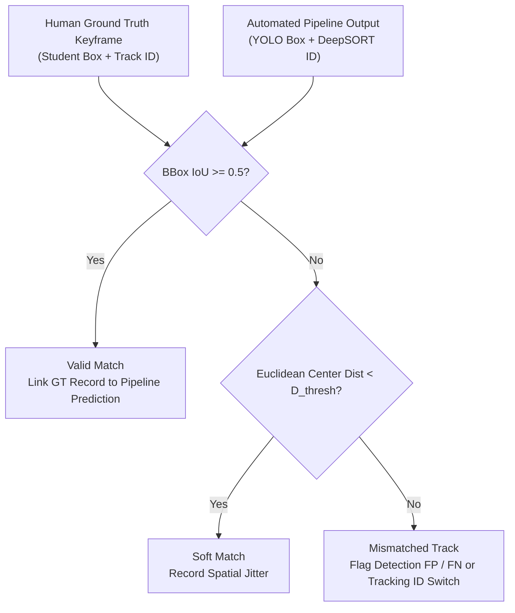
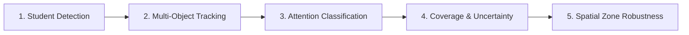

# Minimal Benchmark Design & Honest Evaluation Plan

**Date**: October 27, 2026  
**Author**: Senior Computer Vision Research Engineer & ML Scientist  
**Repository**: `c:\Users\User\Downloads\Model v2\classroom_attention_research`  
**Purpose**: Rigorous experimental design and evaluation specification for individual student attention benchmarking in unseen classroom scenarios.  
**Execution Condition**: Contingent upon explicit authorization gate clearance and IRB/thesis committee sign-off.

---

## 1. Minimal Pilot Specification & Zone Coverage

To minimize annotation overhead while maximizing environmental and spatial diversity, we specify the **smallest statistically useful pilot subset** consisting of exactly **three verified clips** totaling **36.5 seconds of footage** (~1,095 frames at 30 FPS).

### 1.1 Clip Selection Matrix across Classroom Seating Zones

```
+----------------------------------------------------------------------------------------------------+
|                                    MINIMAL PILOT SELECTION MATRIX                                  |
+--------+--------------------+-----------+----------+---------------+------------------------------+
| Clip   | File Path          | Camera    | Duration | Visible Subj. | Primary Benchmark Objective  |
+--------+--------------------+-----------+----------+---------------+------------------------------+
| Clip A | high/view1.mp4     | Front-Ctr | 11.5 sec | 6–8 students  | Front Row Gaze & Board Focus |
| Clip B | low/view3.mp4      | Lat-Angle | 13.5 sec | 8–12 students | Middle Desk Clutter & Slump  |
| Clip C | high/view11.mp4    | Rear-High | 11.5 sec | 10–15 students| Rear Low-Res (<24px) & Occl. |
+--------+--------------------+-----------+----------+---------------+------------------------------+
| TOTAL  | 3 Verified Clips   | 3 Angles  | 36.5 sec | 24–35 tracks  | Cross-Zone Spatial Coverage  |
+--------+--------------------+-----------+----------+---------------+------------------------------+
```

1. **Clip A (`high/view1.mp4`) — Front Zone Benchmark**:
   - **Environment**: Camera View 1 situated in front-center. Bright frontal illumination, high student visibility.
   - **Spatial Focus**: Front row students with large bounding boxes ($>60\text{ px}$ face height).
   - **Evaluation Focus**: Fine-grained facial orientation, eye gaze vectors, teacher tracking, and note-taking validation.

2. **Clip B (`low/view3.mp4`) — Middle Zone & Desk Clutter Benchmark**:
   - **Environment**: Camera View 3 mounted on side wall at an oblique $45^\circ$ angle.
   - **Spatial Focus**: Middle row students with foreground desk occlusions and peer obstructions.
   - **Evaluation Focus**: Postural slump detection, off-task peer banter, and differentiating desk writing vs. hidden mobile device use.

3. **Clip C (`high/view11.mp4`) — Rear Zone & Extreme Distance Benchmark**:
   - **Environment**: Camera View 11 looking down from rear ceiling angle.
   - **Spatial Focus**: Distant students where faces measure $<24\text{ px}$ in height.
   - **Evaluation Focus**: Evaluating the system's ability to trigger `VIS_SEVERELY_OCCLUDED_OR_DISTANT` and output honest `Uncertain` labels rather than hallucinating facial landmarks.

---

## 2. Sampling Interval & Temporal Annotation Rules

Continuous video at 30 FPS exhibits high temporal autocorrelation between adjacent frames. Annotating all 30 frames per second is redundant and prone to micro-glance noise.

### 2.1 Temporal Sampling Frequency
* **Sampling Rate**: $1.0\text{ Hz}$ (Exactly 1 annotation keyframe per second: frames $0, 30, 60, 90, \dots$).
* **Window Duration**: Each keyframe represents the student's modal behavioral state over a $\pm 0.5\text{-second}$ window ($15$ frames before and after).
* **Sample Volume**:
  - Clip A (11.5s): 11 keyframes $\times$ 7 students $\approx 77$ student-second annotation records.
  - Clip B (13.5s): 13 keyframes $\times$ 10 students $\approx 130$ student-second annotation records.
  - Clip C (11.5s): 11 keyframes $\times$ 12 students $\approx 132$ student-second annotation records.
  - **Total Ground-Truth Samples**: **$\approx 339$ high-quality multi-field records**.

### 2.2 Temporal Label Consistency & Smoothing Rule
* **Anti-Flicker Threshold**: A shift in attention label (`Attentive` $\leftrightarrow$ `Inattentive`) must be sustained for **at least 2 consecutive keyframes ($\ge 2.0\text{ seconds}$)** to be coded as a persistent state change.
* **Transient Glances**: A brief glance away from the board or a quick head scratch lasting $<1.0\text{ second}$ is coded as a transient movement under `observable_behaviors`, but does **not** flip an established `Attentive` label to `Inattentive`.
* **Discrete Event Exception**: Immediate state flips are permitted only upon clear discrete events (e.g., student actively slumping head onto desk, or pulling a smartphone from pocket and holding it above desk level).

---

## 3. Track-to-Annotation Matching & Occlusion Handling



### 3.1 Spatial Matching Criteria
1. **Primary Match**: Bounding box Intersection over Union ($\text{IoU}$) $\ge 0.50$ between human annotation bounding box and pipeline detection.
2. **Track Continuity Linking**: When an automated tracker switches ID (e.g., Track ID 3 becomes Track ID 17 after occlusion), the ground-truth evaluator tracks the switch to separate tracking error from attention classification error.

### 3.2 Handling Missing, Ambiguous, and Occluded Students
* **Boundary Occlusion**: If a student is $>70\%$ occluded by furniture or peer bodies, annotators code `visibility_status = VIS_SEVERELY_OCCLUDED_OR_DISTANT`.
* **Honest Prediction Requirement**: The pipeline must predict `UNCERTAIN` or `INSUFFICIENT_VISUAL_EVIDENCE` for this track. If the pipeline outputs a confident `Attentive` or `Inattentive` prediction on an unresolvable face, it is penalized as an **overconfident hallucination error**.
* **Zero Synthetic Imputation**: Missing landmarks or occluded joints must **never** be synthetically fabricated or filled with mean values.

---

## 4. Privacy Safeguards & Data Retention Restrictions

1. **Local-Only Storage**: All raw video files, intermediate crops, and annotation JSON files must reside on local encrypted NVMe drives (`classroom_attention_research/data/`). Uploading raw footage to public cloud annotation platforms (public CVAT instances, Roboflow) is strictly forbidden.
2. **De-Identification & Facial Blurring**:
   - Before any video clip, diagnostic overlay, or visualization is exported for thesis defense slides or publication, student faces must pass through an automated Gaussian de-identification blur.
   - The thesis presentation must only display bounding boxes, skeletal wireframes, and anonymized track IDs (`Student_01`, `Student_02`).
3. **Data Retention & Disposal**: Ground-truth annotation files and intermediate extracted features will be retained strictly for the duration of the thesis defense and academic review, after which raw identifiable crops will be purged.

---

## 5. Five-Stage Honest Evaluation Framework

Evaluation must not collapse into a single aggregate accuracy number. The system must report **five decoupled, independent evaluation stages**:



### Stage 1: Student Detection Evaluation
Evaluates YOLO11's ability to detect classroom occupants under physical seating constraints:
* **Metrics**:
  - Precision ($\text{P}$), Recall ($\text{R}$), and $F_1$-score at $\text{IoU} = 0.50$.
  - Mean Average Precision ($\text{mAP@0.5}$ and $\text{mAP@0.5:0.95}$).
  - Miss Rate ($1 - \text{Recall}$) broken down by seating row.

### Stage 2: Multi-Object Tracking (MOT) & Identity Continuity
Evaluates DeepSORT's ability to maintain student identity continuity over time:
* **Metrics**:
  - **MOTA (Multiple Object Tracking Accuracy)**: Measures detection errors and ID switches:
    $$\text{MOTA} = 1 - \frac{\sum (\text{FN} + \text{FP} + \text{IDSW})}{\sum \text{GT\_Objects}}$$
  - **IDF1 (Identification F1-score)**: Harmonic mean of identification precision and recall, measuring long-term track consistency.
  - **IDSW (Identity Switches)**: Absolute count of track identity jumps.
  - **MT (Mostly Tracked Ratio)**: Percentage of students tracked for $\ge 80\%$ of their visible trajectory.
  - **ML (Mostly Lost Ratio)**: Percentage of students tracked for $<20\%$ of their trajectory.
  - **UTDR (Unsupervised Track Duration Ratio)**: Average unbroken track segment length relative to clip length.

### Stage 3: Individual Attention Classification Evaluation
Evaluates behavioral attention prediction strictly against adjudicated ground truth:
* **Metrics**:
  - **Per-Class Precision, Recall, and $F_1$-Score** for `Attentive`, `Inattentive`, and `Uncertain`.
  - **Macro $F_1$-Score**: Unweighted mean of class $F_1$-scores:
    $$\text{Macro } F_1 = \frac{F_{1,\text{Att}} + F_{1,\text{Inatt}} + F_{1,\text{Uncert}}}{3}$$
  - **Balanced Accuracy**: Arithmetic mean of per-class recalls, guarding against majority-class imbalance.
  - **Confusion Matrix**: Full $3 \times 3$ error distribution matrix:
    $$\begin{pmatrix} C_{\text{Att}\to\text{Att}} & C_{\text{Att}\to\text{Inatt}} & C_{\text{Att}\to\text{Uncert}} \\ C_{\text{Inatt}\to\text{Att}} & C_{\text{Inatt}\to\text{Inatt}} & C_{\text{Inatt}\to\text{Uncert}} \\ C_{\text{Uncert}\to\text{Att}} & C_{\text{Uncert}\to\text{Inatt}} & C_{\text{Uncert}\to\text{Uncert}} \end{pmatrix}$$

### Stage 4: Coverage and Uncertainty Calibration
Evaluates the model's reliability in knowing when it does not know:
* **Metrics**:
  - **Coverage Ratio**:
    $$\text{Coverage} = \frac{N_{\text{Authoritative Predictions (Attentive or Inattentive)}}}{N_{\text{Total Visible Student Keyframes}}}$$
  - **Selective Risk / Accuracy at Coverage**: Accuracy calculated exclusively on the subset of predictions exceeding confidence threshold $\tau \ge 0.80$.
  - **Expected Calibration Error (ECE)**: Measures whether predicted softmax probabilities correspond to true empirical accuracies:
    $$\text{ECE} = \sum_{m=1}^M \frac{|B_m|}{N} |\text{acc}(B_m) - \text{conf}(B_m)|$$

### Stage 5: Spatial Zone Robustness Disaggregation
Metrics must be disaggregated across the physical classroom geometry to evaluate distance and angle sensitivity:

```
+-----------------------------------------------------------------------------+
|                     SPATIAL ZONE DISAGGREGATION TEMPLATE                    |
+-------------------+--------------------+------------------+-----------------+
| Metric            | Front Zone (Row 1) | Middle (Rows 2–3)| Rear (Rows 4+)  |
+-------------------+--------------------+------------------+-----------------+
| Detection Recall  | [Target: >= 95%]   | [Target: >= 90%] | [Target: >= 80%]|
| Tracking IDF1     | [Target: >= 85%]   | [Target: >= 75%] | [Target: >= 65%]|
| Attention Macro F1| [Target: >= 80%]   | [Target: >= 75%] | [Target: >= 65%]|
| Uncertainty Rate  | [Target: <= 10%]   | [Target: 10–25%] | [Target: >= 40%]|
+-------------------+--------------------+------------------+-----------------+
```

---

## 6. Generalization Limits & Session Separation Rules

### 6.1 The Fallacy of Arbitrary Unseen-Classroom Generalization
> [!WARNING]
> **CRITICAL SCIENTIFIC PRINCIPLE**: Evaluating a computer vision system on three clips—even if shot from different camera views—**DOES NOT AND CANNOT PROVE ARBITRARY UNSEEN-CLASSROOM GENERALIZATION**.
>
> In the OUC-CGE dataset, views belong to fixed camera angles inside specific lecture halls at Ocean University of China. High performance on `view1`, `view3`, and `view11` demonstrates **multi-perspective robustness** within that recorded physical room, but cannot establish generalization to:
> - Different architectural layouts (auditoriums vs seminar rooms).
> - Novel lighting environments (fluorescent vs natural daylight).
> - Varying cultural classroom norms (e.g., student uniform requirements, varying desk arrangements).

### 6.2 Strict Session Separation Rules
Whenever training and fine-tuning models:
1. **Never split by frames**: Splitting adjacent frames from the same video clip into train and test sets constitutes catastrophic data leakage.
2. **Never split by camera views of the same time segment**: Training on `view1` at $t=10\text{s}$ and testing on `view2` at $t=10\text{s}$ leaks identical student physical actions into the test set.
3. **Session-Level Splitting Mandate**: The test set must consist of **entirely separate recording sessions** captured on different days with different cohorts of students. If only two sessions exist in the pilot, results must be explicitly reported as a **Within-Session Pilot Validation**, withholding claims of cross-classroom generalization until multi-institution footage is evaluated.
