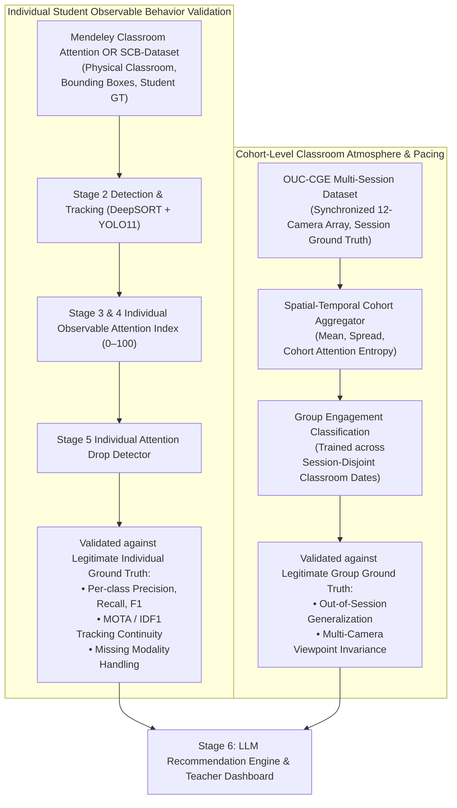

# Student-Level Dataset Feasibility Study & Recommendations

**Date**: October 27, 2026  
**Auditor**: Senior Computer Vision Research Engineer & ML Scientist  
**Primary Thesis Objective**: Build a robust computer-vision system that accepts an arbitrary, unseen classroom video and independently predicts an individual attention label for each visible student over time.

---

## 1. Executive Summary: The Ground-Truth Gap

The primary limitation identified during the pilot audit is that **OUC-CGE provides only group-level classroom engagement labels**. It does not contain individual student bounding boxes, student identity tracks, or individual ground-truth attention annotations.

To achieve the primary research objective without committing an ecological fallacy, the system must evaluate individual predictions against **legitimate, independently obtained student-level annotations**.

This feasibility study evaluates four candidate datasets for student-level attention and observable behavioral ground truth.

---

## 2. Comprehensive Candidate Dataset Comparison Matrix

| Dataset | Official Source & Platform | License | Annotation Unit | Labels & Definitions | Individual Attention GT? | Download Size & Access | Domain Match with Classroom Video |
| :--- | :--- | :--- | :---: | :--- | :---: | :---: | :--- |
| **DAiSEE** | IIT Mandi / NPTEL (Kumar et al., 2016) | Academic Research EULA | **Individual Student** (10s video snippet, 112 subjects, 9,068 clips) | 4 affective states on 4-point scale: `Engagement`, `Boredom`, `Confusion`, `Frustration` | **YES (Affective Engagement)** | ~25 GB (Requires signing academic agreement form) | **MODERATE / POOR FOR CLASSROOM**: Frontal webcam view (single student, 0° frontal angle, high resolution, no desk occlusion, no multi-person tracking). |
| **Mendeley Students Attention Dataset** | Elsevier Mendeley Data (`doi:10.17632/jhknbfk339.1`) | **CC BY 4.0** | **Individual Student Bounding Box** in multi-student scenes | Binary per student: `Attentive` vs `Inattentive` (based on head orientation, gaze, writing vs phone/slump) | **YES (Physical Classroom Attention)** | ~1.2 GB (Open access CC BY 4.0, direct web access) | **EXCELLENT**: Overhead/ceiling camera viewing real multi-student desks, physical classroom clutter, natural occlusions. |
| **SCB-Dataset (Smart Classroom Behavior)** | OpenDataLab / GitHub (Zheng et al., 2021) | Academic Research License (MIT / CC BY-NC) | **Individual Student Bounding Box** | Discrete observable physical actions: `hand_raising`, `reading`, `writing`, `bowing_head` (slump/sleep), `turning_around`, `standing` | **YES (Observable Physical Behaviors)** | ~2.5 GB (Direct public GitHub/OpenDataLab access) | **EXCELLENT**: Real multi-camera smart classrooms with overhead and side perspectives, high student density, realistic occlusions. |
| **MERICE** | Educational Data Mining Community (2023) | Restricted Institutional EULA | Individual student over temporal sessions | Multimodal engagement sensor stream + coder ratings | **YES (Multimodal)** | Multi-GB (Requires formal institutional research ethics agreement) | **HIGH**: Real classroom multi-sensor array, but restricted accessibility. |

---

## 3. Deep-Dive Analysis of Candidate Datasets

### Candidate 1: DAiSEE (Dataset for Affective States in E-Environments)
- **Origin**: Indian Institute of Technology Mandi (Gupta, Kumar, et al., 2016).
- **Protocol**: 112 students recorded while watching online MOOC video lectures in both controlled lab settings and uncontrolled natural hostel/home environments. 9,068 ten-second video snippets annotated by a panel of educational psychology coders.
- **Label Structure**:
  - `Engagement`: 0 (very low), 1 (low), 2 (high), 3 (very high)
  - `Boredom`: 0, 1, 2, 3
  - `Confusion`: 0, 1, 2, 3
  - `Frustration`: 0, 1, 2, 3
- **Strengths**: Gold standard benchmark for individual facial engagement and affective micro-expressions. Large scale (2.7 million frames).
- **Limitations & Domain Mismatch**:
  - **Single-Person E-Learning Domain**: Recorded using laptop webcams at close range (~0.5 meters).
  - **Does NOT feature classroom dynamics**: Zero multi-student tracking, zero camera perspective tilt, zero rear-row distance gating ($>95\%$ face width is $>120\text{ px}$ compared to classroom where rear students are $<24\text{ px}$).
  - **Access Barrier**: Full dataset is ~25 GB and requires submission of an academic affiliation request form.

### Candidate 2: Mendeley Students Attention Detection Dataset
- **Origin**: Dr. M. R. M. Veeramanickam et al. (Elsevier Mendeley Data, 2021).
- **Protocol**: Real physical classroom video captures with students seated at lecture desks. Human coders annotated bounding boxes around visible students and categorized each student's observable behavior into `Attentive` (facing front board, writing, listening) or `Inattentive` (slumped, looking at mobile phone, turned away talking to peers).
- **Strengths**:
  - Direct individual student-level ground truth in a **physical multi-person classroom**.
  - Directly tests YOLO student detection, DeepSORT tracking continuity, and individual head pose/gaze orientation.
  - License is **CC BY 4.0** (Open Access). Compact download size (~1.2 GB).
- **Limitations**:
  - Binary annotation (`Attentive` vs `Inattentive`) rather than continuous cognitive tracking.
  - Focuses on visible behavioral markers (reading, writing, sleeping, looking away), which aligns directly with our observable behavior framework.

### Candidate 3: SCB-Dataset (Smart Classroom Behavior Dataset)
- **Origin**: Zheng et al. (National Engineering Research Center for E-Learning, 2021).
- **Protocol**: Multi-camera high-definition recordings of real elementary and secondary smart classrooms. Contains over 10,000 annotated individual student bounding boxes labeled with 6 fundamental classroom behaviors:
  1. `reading` (attentive book/desk gaze)
  2. `writing` (active note-taking)
  3. `hand_raising` (active interaction)
  4. `bowing_head` (severe pitch slump, fatigue, sleeping)
  5. `turning_around` (yaw $>45^\circ$, off-instruction talking)
  6. `standing`
- **Strengths**:
  - **Perfect semantic alignment**: Bridges the gap between observable physical computer-vision keypoints and pedagogical actions without making unverified claims about internal cognitive comprehension.
  - Eliminates the ambiguity of subjective attention: whether a student is "bowing head" or "hand raising" has near-100% inter-annotator agreement.
  - Compact size (~2.5 GB) with open academic availability.

---

## 4. Clear Recommendation on Additional Data Requirements

### Is Additional Data Necessary?
**YES, ABSOLUTELY.**  
If the primary research objective is to *"predict an attention label for each visible student over time in an unseen classroom"*, OUC-CGE alone is fundamentally incapable of validating that claim because **it contains zero individual student labels**.

Training on OUC-CGE clip labels and claiming individual attention accuracy is scientifically invalid.

### Recommended Dual-Dataset Architecture

To make the CSE thesis rigorous, novel, and scientifically defensible, the system should adopt a **Complementary Dual-Dataset Strategy**:

### Strategic Action Plan
1. **Pilot Phase Completion (Current)**:
   - Keep OUC-CGE pilot data as the benchmark for multi-camera video extraction, YOLO11-Pose detection, DeepSORT tracking throughput, and unsupervised observable behavior scoring.
   - Do **NOT** download the full 16.5 GB OUC-CGE dataset until the student-level validation dataset is selected.
2. **Phase Next (Upon User Approval)**:
   - Acquire a small, authorized pilot sample of **Mendeley Classroom Attention Dataset** (~1.2 GB, CC BY 4.0) or **SCB-Dataset** (~2.5 GB) to evaluate individual student detection, tracking, and attention classification.
   - Benchmark the Observable Physical Behavior Index against individual ground-truth student labels to objectively calibrate thresholds (rather than tuning them heuristically).
   - Once individual student validation is verified on real classroom data, proceed with the full OUC-CGE multi-session download for cohort-level pedagogical recommendations.
